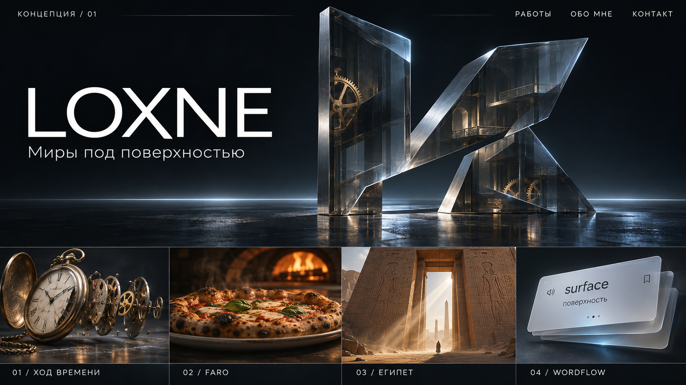
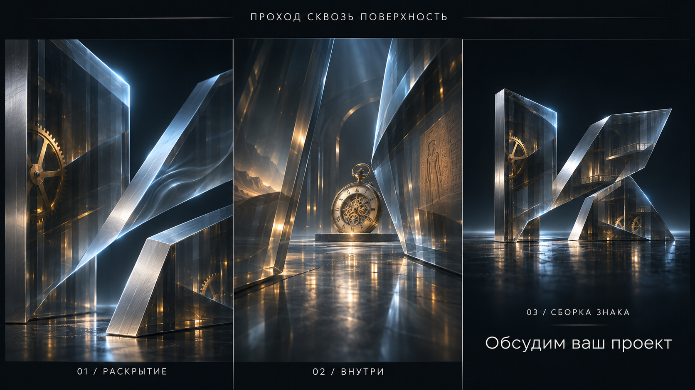

# LOXNE — «Миры под поверхностью»

Дата: 2 ноября 2026 года. **Статус: предложенный дизайн, ожидает review пользователя.**

Основание: `PROMPT_PORTFOLIO_AGENT.txt`, исследование четырёх репозиториев и живых референсов. Концепция миров внутри монолита выбрана в исходном брифе; детализация в этом документе и приложенные кадры ещё не одобрены. Продуктовый код и реализационный план пока не создавались.

## 1. Что создаём

Персональное русскоязычное портфолио разработчика сайтов. Заказчик должен сначала почувствовать качество композиции, материалов и взаимодействия, затем увидеть четыре настоящие работы и понять техническую роль автора. Главный образ — монолит, внутри которого обнаруживается галерея. Результат — локальное приложение с предпросмотром, исходниками, проверенными кейсами и шоурилом. Публикация и изменение исходных репозиториев не входят в работу.

Временное имя — LOXNE. Из персональных ссылок подтверждён только GitHub. Имя, описание, ссылки, тексты и порядок проектов меняются через единый модуль конфигурации. Число клиентов, награды, коммерческие результаты и личные контакты не выдумываются.

## 2. Выбор постановки

Рассмотрены три способа реализовать выбранную концепцию:

| Подход | Сильная сторона | Ограничение |
| --- | --- | --- |
| **Три рассечённые стеклянные пластины — рекомендуемый** | Уникальный силуэт, явный проход, контролируемая толщина стекла; те же детали образуют финальный знак | Требует точной постановки срезов и отражений |
| Цельный кристалл с преломляющей сердцевиной | Сильная предметность и простая внешняя форма | Миры труднее показать через материал; дороже прозрачность; риск получить обычный драгоценный камень |
| Пространственный портал из металлических рёбер | Легче рендер и ясная глубина | Слабее идея закрытой поверхности и её открытия |

Выбранное предложение — три пластины. В отличие от типового куба, форму определяет косой сквозной разрез: тяжёлая вертикаль слева, длинная восходящая грань справа и короткая нижняя опора. Силуэт асимметричен, но визуально устойчив. Внутри — несколько крупных латунных дуг, архитектурных фрагментов и тонких пластин. Не строим огромный детальный город, который всё равно не читается в первом кадре.

Объект приблизительно 4 условных единицы высотой, 2,5 шириной и 0,65 глубиной. Фаски 0,03–0,06 единицы. Диагональная щель — около 12–16% ширины в закрытом положении. Это начальные параметры для художественной итерации, не обязательные физические размеры.

Внешние грани — дымчатое стекло, торцы — холодный сатинированный металл. Стекло действительно имеет толщину; блеск концентрируется на срезах. Крупные отражающие источники и контровой свет важнее многочисленных частиц. Пол тёмный, отражение ограничено по яркости и расстоянию. Постоянный сильный bloom, хроматическое расслоение и бесконечное вращение не используются.

## 3. Визуальные материалы для review

Это **концепт-арты Imagegen**, а не скриншоты работающего сайта, исходных приложений или готовых моделей. Их назначение — согласовать силуэт, масштаб, свет, композицию и смену холодного/тёплого настроения. Часы и пицца в этих изображениях иллюстративны; в продукте используются проверенные исходные модели и реальные экраны. Финальный знак строится из тех же трёх частей; не требуется буквально воспроизвести сгенерированную геометрию.

Нижняя полоса первого изображения — раскадровка четырёх эпизодов. Она не означает сетку из четырёх маленьких карточек на первом экране. Каждый мир получает собственный полноценный экран.

## 4. Композиция и типографика

Desktop: сетка 12 колонок, внешние поля около 4,5vw. Имя занимает левые 5 колонок, монолит — центральную и правую часть. Тонкая линия горизонта соединяет композицию. В шапке — LOXNE, «Работы», «Обо мне», «Контакт»; внизу первого экрана — понятная подсказка прокрутки и ссылка «Сразу к работам». Меню остаётся доступным в каждом состоянии.

Заголовок: «Миры под поверхностью». Подпись: «Разрабатываю сайты, в которых дизайн, движение и код работают вместе». Текст редактируемый; он описывает специализацию без неподтверждённых достижений.

Предлагаемый шрифт — локальный Manrope с полноценной кириллицей, уже присутствующий в проектах автора и лицензированный OFL. Крупное LOXNE набрано этим же семейством с отдельным трекингом. Моноширинные подписи — системный стек, чтобы не загружать лишнее семейство. Типографика FARO сохраняет характер его исходного интерфейса в реальных экранах, но внешняя оболочка кейса едина для портфолио.

Палитра: фон `#080B10`, поверхность `#111720`, серебро `#CBD2D9`, основной текст `#F1F0EA`, холодный акцент `#9BC9FF`, FARO `#F4A04B`. Текст располагается на спокойной области или контролируемом затемнении; блик не проходит сквозь основной текст.

Mobile: имя и подзаголовок сверху, монолит ниже и по центру. Боковой разрез сохраняется, ракурс становится более фронтальным. Подписи не накладываются на главный объект. Ссылки и кнопки имеют область касания от 44×44 px. Высота рассчитывается через стабильные viewport units с учётом панели браузера; при resize прогресс главы сохраняется.

## 5. Раскадровка и прокрутка

Прокрутка браузера остаётся нативной. Главы — реальные HTML-секции; canvas закреплён за сценическим контейнером. У каждой главы есть собственный нормализованный progress и диапазон спокойного чтения. Примерная общая длина desktop — 12–15 высот экрана; mobile — 10–12. Окончательная длина корректируется по фактическому темпу.

| Кадр | Камера и объект | Текст / действие | Мобильная версия |
| --- | --- | --- | --- |
| 01. Знакомство, ~1,2 экрана | Почти статичный монолит в 3/4; внутренний механизм виден частично | LOXNE, специализация, «Сразу к работам» | Монолит под заголовком; без реакции на отсутствующий hover |
| 02. Раскрытие, ~1,3 | Пластины расходятся на 0,25–0,5 ширины; камера приближается к косому проходу. Краткая волна только на одной плоскости | Текст постепенно освобождает проход; меню остаётся | Более короткое приближение; щель заранее читаема |
| 03. Внутри, ~0,7 | Передние срезы уходят за края кадра; за ними проявляется первый экспонат. Без белой вспышки и потери ориентации | Номер 01 и название часов | Меньший параллакс, без резкого изменения FOV |
| 04. Ход времени, ~2 | Общий вид → 3–4 группы деталей расходятся по выстроенной оси → пауза с видимым механизмом | «Точность, которую можно рассмотреть»; 47 деталей; «Открыть кейс» | Раскрытие преимущественно по вертикали; часть деталей объединяется в визуальные группы |
| 05. FARO, ~2 | Холодная грань становится янтарной. Пицца на керамике, низкий средний ракурс, короткий облёт 45–70°, затем остановка | «Тёплый свет. Настоящий объём»; подпись «Демонстрационный сайт»; кейс | Сохранён объём бортика, пицца целиком помещается; меньше углового движения |
| 06. Египет, ~1,8 | Портал крупнее камеры; боковой свет, несколько слоёв архитектуры, редкие частицы; движение между опорами | «История становится пространством»; семь глав; кейс | Упрощённые колонны, меньше частиц, тот же силуэт прохода |
| 07. Wordflow, ~1,8 | Тонкие пластины собираются в экран телефона; движение останавливается до интерактивной демонстрации | «От впечатления — к действию»; переворот, ответ, прогресс, словарь; кейс | Настоящие HTML-кнопки и карточка; вертикальное расположение |
| 08. Автор и процесс, ~1 | Камера спокойна, дальние грани почти исчезают | Три шага: задача → прототип → реализация и проверка. Шоурил по кнопке | Обычный доступный HTML |
| 09. Возвращение, ~1,5 | Обратный отъезд; четыре мира оказываются внутри. Три грани поворачиваются и сходятся в компактный персональный знак | «Обсудим ваш проект»; реальная доступная контактная ссылка | Короткая сборка, достаточно места для кнопки |

Во время пауз камера не продолжает бесконечный дрейф. При обратной прокрутке трансформации вычисляются из абсолютного progress, без накопления ошибок. «Сразу к работам» переводит на начало часов, минуя вводный пролёт. Пункт «Работы» раскрывает компактный список четырёх прямых ссылок и ссылку на галерею.

## 6. Четыре мира: факты и новая подача

### Ход времени

Используется копия `pocket-watch.glb`: 47 логических деталей, 120 704 треугольника, 3 020 672 байта; исходный `.blend` доступен. Сохраняется таблица узлов и rest-transforms. Полированная латунь, матовая сталь и стекло получают различимый свет. Сначала целый объект, затем механизм; отдельные детали доступны для осмотра в кейсе.

В исходном приложении разборка работает от ползунка. Управление от прокрутки — **новая режиссура портфолио**. Не утверждаем историческую достоверность или симуляцию часов. Публичное исходное демо не подтверждено; в кейсе будет локальная демонстрация механизма и ссылка на GitHub.

### FARO

Используется `pizza-web.glb`: 49 964 треугольника, 3 552 568 байт, Meshopt + WebP. Сохраняются исходный GLB и `.blend` вне публичной сборки, а также Rigsters / CC BY 4.0 и список изменений. Визуальное направление — тёмная керамика, низкий средний ракурс, жар сбоку, небольшое пространство вокруг. Экстремальное макро начинки не применяется: исходная текстура 1024² ограничивает фактуру даже после увеличения.

Реальная исходная работа: 3D-облёт, остановки, меню, фильтры, размеры, локальная корзина и самостоятельный осмотр. Это вымышленная пиццерия без оплаты и отправки заказов. Публичное демо доступно; главная сцена проверена в браузере. В кейсе показываются реальные меню и корзина, не сгенерированные экраны.

### Египет

Новая презентационная геометрия: две монументальные опоры с фасками и верхняя перемычка, несколько планов за порталом. Песок и фактура ограничены; акцент на масштабе и направленном свете. Реальные экраны исходного сайта показывают семь глав и связь текста с прокруткой.

Исходный проект сочетает растровый портал и простые объёмные опоры. На узких экранах он переходит к HTML-чтению. Подробная сцена и мобильная 3D-постановка портфолио не приписываются исходному проекту. Публичное демо не подтверждено: локальный просмотр или запись плюс репозиторий.

### Wordflow

Материал — тонкие светлые пластины и спокойные холодные торцы. Визуальный переход ведёт к доступной HTML-демонстрации, не к canvas-тексту. Набор из 6 вымышленных слов: surface, craft, motion, depth, light, explore. Действия: перевернуть, «Знаю» / «Не знаю» / «Трудно», увидеть прогресс, открыть словарь, сбросить демо. Свайпы не демонстрируются как функция оригинала.

Демо работает только с собственным состоянием, без Telegram и запросов к реальным профилям. Реальные механизмы Telegram-проверки, D1, offline cache и конфликтов синхронизации объясняются в кейсе схемой. Исходное приложение требует Telegram; публичная ссылка подписана соответствующим образом. Снимок рабочей базы из репозитория не читается и не попадает в портфолио.

## 7. Кейсы, контакты и семантика

Маршруты: `/`, `/work/timepiece`, `/work/faro`, `/work/egypt`, `/work/wordflow`; дополнительно компактная страница источников `/credits`. Неизвестный путь показывает понятную 404 с возвратом к работам.

Каждый кейс содержит: крупную обложку из проверенной сцены, краткую задачу, роль и статус, основной приём, реальные экраны/запись, технический разбор, доступное демо или честно обозначенную локальную демонстрацию, GitHub, следующий кейс. Отдельная ссылка «Вернуться в галерею» восстанавливает её место. Заголовки, кнопки, описания и ссылки находятся в HTML.

Верхнее меню и ссылки доступны с клавиатуры. После смены страницы фокус переходит на основной заголовок; при возврате в галерею — на ранее открытый проект без лишнего скачка прокрутки. `aria-live` сообщает ошибку загрузки, но не каждое изменение 3D-progress.

Пока личный email или Telegram автора не предоставлен, контактный блок показывает подтверждённый GitHub. Металлическая кнопка называется «Открыть GitHub» и ведёт на профиль. После заполнения `author.contact` она может называться «Написать мне». Пустые `mailto:`, формы без отправки и чужой бот в качестве личного контакта исключены.

## 8. Переходы и состояние навигации

Единая мембрана с выгнутым краем и светлым металлическим торцом закрывает страницу. В центре кратко показано название следующего кейса. Плановая длительность 0,8–1,2 с, предварительная схема: фокус объекта 0–0,15 с, закрытие 0,15–0,5, смена маршрута при полном покрытии, раскрытие 0,5–1,0. Одни и те же состояния применяются при Back/Forward.

Контроллер хранит состояние `idle → closing → covered → opening → idle`, токен актуального перехода и одну последнюю ожидающую навигацию. Двойной клик по той же цели игнорируется; другая цель заменяет ожидающую, а не создаёт второй таймлайн. При исключении обработчик гарантированно снимает блокировку, возвращает фокус и показывает страницу/сообщение. Контент кейсов поставляется в основном приложении: отсутствие тяжёлой модели не блокирует переход.

Скролл сохраняется по ключу записи history, дополнительно запоминаются глава галереи и локальный progress. Прямой вход в кейс не требует запуска монолита. Обычный вход через меню начинает кейс сверху; браузерный возврат восстанавливает предыдущую запись. Если кейс открыт напрямую и сохранённого места нет, «Вернуться в галерею» ведёт к соответствующему миру, устанавливает его спокойный кадр и фокусирует заголовок. Не перехватываются ctrl/cmd-click, открытие в новой вкладке и внешние ссылки.

Ближайший постер и данные проекта предзагружаются при приближении к главе, hover или focus ссылки. Тяжёлая модель загружается по главе и наличию ресурса; связь `saveData`/мобильное качество ограничивает prefetch. Ошибка ассета оставляет постер и тексты, предлагает повторить. Reduced motion использует короткое затухание или мгновенную смену без пролёта.

## 9. Архитектура

Предложение: React + TypeScript + Vite, Three.js напрямую, GSAP + ScrollTrigger и небольшой маршрутизатор на базе React Router. Нативная прокрутка без Lenis. Один управляющий ticker для камеры, материалов и UI-переходов; внутри `render()` не создаётся второй animation loop. Remotion расположен отдельно от runtime сайта и не попадает в его основной bundle.

Версии закрепляются в lockfile после разрешённой установки и проверки актуальных API. Версии из чужих package.json не копируются автоматически. Sites используется в режиме **local-only**, без регистрации проекта и деплоя.

| Предлагаемый модуль | Ответственность / контракт |
| --- | --- |
| `src/content/portfolio.ts` | Автор, четыре проекта, ссылки, тексты, доказательства, порядок и credits |
| `src/experience/types.ts`, `story.ts` | `ChapterId`, `ExperienceState`, нормализованные диапазоны, абсолютная выборка позы камеры |
| `src/experience/Experience.ts` | Один renderer/canvas, жизненный цикл, resize, visibility, обработка ошибок |
| `src/experience/worlds/Monolith.ts` | Три пластины, внутренние силуэты, раскрытие, волна и финальная сборка |
| `src/experience/worlds/{Timepiece,Faro,Egypt,Wordflow}.ts` | Независимые миры: `load(signal)`, `setProgress(p)`, `update(frame)`, `setQuality(q)`, `dispose()` |
| `src/experience/CameraDirector.ts` | Позиция, target и FOV по главе и layout; без доступа к DOM-навигации |
| `src/experience/AssetManager.ts` | Загрузка, отмена, кеш и учёт владельцев общих ресурсов |
| `src/experience/QualityManager.ts` | Профиль качества, DPR, число частиц, решение о снижении качества |
| `src/navigation/TransitionController.ts`, `ScrollMemory.ts` | Мембрана, смена маршрута, блокировки, history, focus и восстановление скролла |
| `src/pages/{Home,CasePage,Credits,NotFound}.tsx` | Семантическое содержание; кейс получает project id из маршрута |
| `src/components/WordflowDemo.tsx` | Изолированная интерактивная демонстрация с синтетическим состоянием |
| `src/styles/` | Сетка, типографика, доступные состояния, mobile и reduced motion |
| `public/assets/` | Только необходимые браузерные GLB, текстуры, постеры и финальное видео |
| `assets/source/` | Копии BLEND, генераторы, provenance и оригиналы; не входит в dist |
| `remotion/` | Композиция шоурила и коротких превью, локальные монтажные исходники |

Данные движутся от DOM-scroll к чистой функции выбора состояния, затем к CameraDirector и активному миру. React не перерисовывает дерево на каждый кадр; HTML меняется на границах смысловых состояний. GSAP отвечает за шкалу времени и переходы, Three.js — только за графику.

## 10. Производительность и устойчивость

Первый HTML и постер доступны до загрузки 3D. Геометрия монолита лёгкая и может генерироваться локальным кодом; Blender CLI используется только после обнаружения работоспособной установки. Отсутствие Blender MCP не блокирует проект. Исходники геометрии сохраняются редактируемыми.

Одновременно активен один полноценный мир, соседний можно держать подготовленным; старые миры освобождают GPU-ресурсы. Общие текстуры не освобождаются, пока есть потребители. В скрытой вкладке ticker прекращает графическую работу. Для неактивного статичного состояния рендер выполняется по необходимости.

Начальные профили: desktop DPR до 1,5; mobile до 1,25; low до 1,0. Число частиц 100–180 / 40–60 / 0. На слабом устройстве снижаются transmission, разрешение отражения и частицы; материалы и силуэт сохраняются. Пол не требует полного второго рендера всей сцены: сначала используется дешёвое постановочное отражение. Более дорогой способ добавляется только после измерения его пользы.

Контекст WebGL2 проверяется до инициализации. При ошибке создания/потере контекста доступны постер, меню, все кейсы и HTML-демо; кнопка повторного запуска не перезагружает весь сайт. При восстановлении графики восстанавливаются текущая глава и поза камеры. Loader завершает все обещания успехом или обработанной ошибкой; бесконечный прелоадер исключён.

Reduced motion: законченные неподвижные кадры, короткие переходы, без автоматического пролёта, волн, анимированного текста и autoplay видео. Условия можно менять во время сеанса с корректным teardown.

Цели 60 FPS desktop / 30 FPS mobile проверяются, а не обещаются. Отчёт укажет viewport, browser, GPU/device если доступен, длительность измерения, медиану/p95 времени кадра и диапазон DPR. Узкое окно desktop не считается испытанием на реальном телефоне. Визуальный осмотр остаётся обязательным даже при успешных тестах.

## 11. Второстепенные эффекты

- LOXNE: небольшое изменение формы/яркости букв возле курсора; единая доступная строка для скринридера.
- Материал монолита: локальная затухающая волна от нажатия; движение света с инерцией, а не вращение всей сцены за курсором.
- Блок автора: спокойное перетекание коротких слов «дизайн / движение / код», стабильный доступный текст.
- Контакт: металлический блик одной кнопки средствами CSS или общей сцены, без дополнительного canvas.
- Image Trail не включается в первую версию: четыре проекта достаточны, дополнительный архив пока не даёт содержательной пользы. Это соответствует условию брифа «если действительно нужна».

## 12. Видео

Шоурил Remotion — 22 секунды, 1920×1080, 30 FPS, без обязательного звука. Ориентировочный монтаж: 0–3 монолит; 3–7 часы; 7–11 FARO; 11–15 Египет; 15–19 Wordflow; 19–22 сборка знака. Это отдельная монтажная шкала, не скорость прокрутки сайта.

Источники — реальные подготовленные кадры/записи приложения и сцен. Существующий восьмисекундный тизер FARO может войти как один из фрагментов. Concept art не выдаётся за работающую графику. Композиция сначала открывается и проверяется в Studio по навыкам Remotion, затем экспортируется в MP4 H.264; короткие превью 4–6 с и WebM создаются там, где улучшают интеграцию. Poster и lazy loading обязательны. Видео не заменяет интерактивный монолит.

## 13. Ресурсы и права

Исследовательские checkout находятся в `.research/` и исключены из Git через локальный exclude. В приложение переносится только явный перечень ресурсов, не весь репозиторий. Базы, профили, `.openai` исходных проектов и прочие runtime-данные не входят в материалы.

Сводный список: часы — GLB/BLEND, данные 47 узлов, DejaVu notice; FARO — сжатый GLB, BLEND, Rigsters CC BY 4.0, изменения и credits; Египет — разрешённые художественные материалы и музейные источники при использовании; Wordflow — синтетические демонстрационные данные и notices скопированных шрифтов/IPA. У собственных проектов не найден общий LICENSE; это не означает, что сторонние материалы теряют свои условия. Не добавляем произвольную общую MIT-лицензию.

Новые ресурсы: монолит и его исходник/генератор; керамическая сцена FARO; детализированный портал; пластины Wordflow; реальные обложки и экраны; записи; Remotion-композиции и экспорт. Подробные подтверждения: [часы и FARO](../../research/timepiece-faro.md), [Египет и Wordflow](../../research/egypt-wordflow.md), [референсы](../../research/references.md), [среда и браузер](../../research/environment-and-browser.md).

## 14. Критерии проверки реализации

1. Первый кадр читается до/после 3D-загрузки; монолит удерживает внимание в статике; текст не перекрыт бликами.
2. Начало, середина и конец прохода сохраняют ориентацию; есть паузы; обратная прокрутка корректна.
3. Все четыре мира доступны из меню, имеют отличимые материалы и реальные сведения. FARO занимает полноценный эпизод.
4. Прямые URL, 404, четыре кейса, возврат в галерею с сохранённым местом и без него, Back/Forward, быстрые повторные клики и клавиатура проходят проверку.
5. Ошибка GLB, отказ WebGL, потеря/восстановление контекста, slow load и reduced motion не закрывают содержание.
6. Ширины 360, 390, 768, 1440, 1920 px; высокое/низкое окно, масштаб текста 200%, отсутствие горизонтального переполнения и скрытых действий.
7. Повторная навигация не накапливает canvas, listeners и GPU-ресурсы. Показания памяти сравниваются после одинакового цикла.
8. Осмысленные unit-тесты проверяют прогресс/обратимость камеры, state machine перехода, scroll memory и ошибки загрузки; browser checks подтверждают совместную работу.
9. Typecheck, необходимые тесты и production build проходят; реальные результаты записаны отдельно от плановых целей.
10. Передача включает работающий локальный URL, инструкции запуска/сборки, конфигурацию, источники, ключевые кадры и запись движения. Неизмеренные устройства и ограничения перечислены честно.

## 15. Следующая обязательная стадия

На review вынесены: форма из трёх пластин, композиция первого экрана, порядок часов → FARO → Египет → Wordflow, история раскрытия/возвращения, мобильная постановка и предложенная архитектура. После одобрения этого документа применяется `writing-plans`, создаётся отдельный конкретный план с файлами и проверками. План проходит свой review перед продуктовым кодом. Метод исполнения — субагенты в этом чате — уже запрошен пользователем; повторно выбирать его не требуется, если предпочтение не изменится.

Самопроверка документа: нет незаполненных разделов; новый рендер отделён от фактов исходников; контакт имеет действительное назначение; local-only и отсутствие публикации согласованы; тяжёлые ресурсы не блокируют HTML-навигацию. Стадии реализации ещё не выполнены и не объявляются одобренными.
